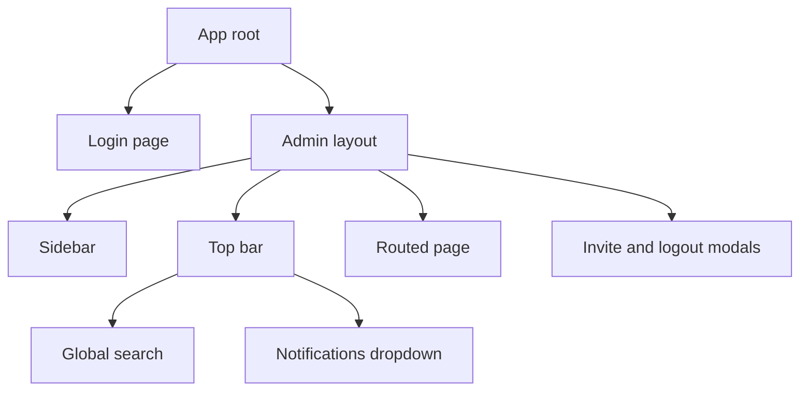

# SmartMoney Intelligence: Admin Interface

Angular 21 implementation of the SmartMoney Intelligence admin portal. The application is a
one-to-one translation of the Figma prototype held in `Figma Design`, with the same layout,
colour system, typography and status vocabulary.

Version 1.3, last updated 13 October 2026. Owned by Eclectics, SmartMoney Intelligence. You need
Node.js 20 or later and npm. Related reading: the [service README](../backend/README.md), the
[API contract](../docs/api-contract.md), the [NCBA integration setup](../docs/ncba-integration-setup.md)
and the [domain knowledge](domain-knowledge.md) notes.

## Running the application

The project uses Windows native build binaries, so run it from Windows PowerShell rather than from
inside WSL.

```powershell
cd "C:\Users\user\Desktop\ECLECTICS\SM-Intelligence\admin-interface"
npm start -- --port 4300
```

Open `http://localhost:4300/admin/login`. Use port 4300: the web app uses 4200, and api-gateway only
accepts browser requests from 4200 and 4300. On any other port, sign in fails with "Could not reach
the identity service".

Sign in with an identity-service account whose email is listed in `ADMIN_EMAILS` (see
[backend setup](../backend/README.md)). The password is the one that account uses on the web app, and
a forgotten one is reset from the web app's "Forgot password?" link. Sign in needs api-gateway (8080)
and identity-service (8081). The bank screens need bank-integration-service (8090) and say so when it
is not running.

To produce a production bundle, run `npm run build`. The output is written to `dist/smartmoney-admin`.

## Tests

Unit tests use Vitest with jsdom, the same setup as the web app. Test files sit next to the code as
`*.spec.ts`.

```powershell
npm test              # run every test once
npm run test:watch    # rerun tests as files change
```

The tests cover sign-in state and token expiry, the route guards, staff role permissions, CSV export
and date formatting. The Frontend CI workflow (`.github/workflows/frontend-ci.yml`) runs the tests and
a production build on every pull request that changes `admin-interface` or `web`.

## Technology

The portal is built with Angular 21 standalone components, using signals and zoneless change
detection. Styling is Tailwind CSS v4 through `@tailwindcss/postcss`. There is no component library:
every primitive is hand built to match the design. Routing uses the Angular Router with an
authentication guard and a login guard.

## How the design was translated

The prototype is a single `App.tsx` file of approximately 1,850 lines. The translation preserves
three things exactly.

1. Theme tokens. `src/styles.css` reproduces the prototype `index.css`, including the `:root` and
   `[data-theme="dark"]` custom properties, the animation keyframes, and the `.delay-*`,
   `.card-hover`, `.animate-*` and `.otp-input` utility classes.
2. Utility classes. Every Tailwind class in the prototype is reused as written, including
   arbitrary values such as `bg-[var(--green-soft)]` and `text-[10px]`.
3. Content. The prototype's mock records were removed. `src/app/core/data.ts` now holds only
   navigation, labels and the record types, and its record arrays are empty; screens read live data
   from the backend or say that they are not connected.

The framework change forced two small deviations. Gradients use inline `linear-gradient` styles
instead of `bg-gradient-to-br from-* to-*`, which renders the same and is not affected by Tailwind v4
renaming utilities. The animation stagger delay is set as an inline `animation-delay`, because a
component host element already carries static classes and a second class binding would be ambiguous.

## Application structure

```text
src/app/
    core/       Types, API gateways, theme, authentication, UI state, route guards
    shared/     Badge, KpiCard, SurfaceCard, Avatar, BankLogo, BarChart,
                Toggle, SettingsField, SettingsInput
    layout/     AdminLayout, Sidebar, TopBar, GlobalSearch, NotifDropdown,
                InviteModal, LogoutModal
    pages/      login, dashboard, organisations, users, bank-integrations,
                bank-accounts, transactions, reconciliation, notifications,
                audit-logs, reports, settings
public/banks/   Bank logo assets served at runtime
```



## Routes

| Route | Screen | Component |
| --- | --- | --- |
| `/admin/login` | Login and two factor | `LoginPage` |
| `/admin/dashboard` | System overview | `Dashboard` |
| `/admin/organisations` | Organisation management | `Organisations` |
| `/admin/users` | Customers (`?type=individual` or `?type=organisation`) | `Users` |
| `/admin/bank-integrations` | Bank health | `BankIntegrations` |
| `/admin/bank-accounts` | Account monitoring | `BankAccounts` |
| `/admin/transactions` | Transaction monitoring | `Transactions` |
| `/admin/reconciliation` | Reconciliation queue | `Reconciliation` |
| `/admin/notifications` | Notification centre | `NotificationsPage` |
| `/admin/audit-logs` | Audit trail | `AuditLogs` |
| `/admin/reports` | Reporting | `Reports` |
| `/admin/settings` | Seven settings sections | `Settings` |

## Layout and scrolling

The shell is a fixed height flex column: sidebar, top bar and a bounded content region. Each page
host element is a flex item with `min-height: 0`, and each page provides its own scroll container
through `overflow-auto`. This keeps the top bar and sidebar in place while page content scrolls,
which matches the behaviour of the prototype.

## Backend contract

The interface consumes the Spring Boot REST API. Bank connectivity is never handled by the
frontend, so the browser never holds a bank credential.

- **Dashboard** reads `/api/v1/admin/stats` and `/api/v1/admin/stats/events`. Its notification
  volume and recent activity each have an "Export CSV" button (no amounts, as on screen).
- **Bank integrations** reads `/api/v1/admin/bank-integrations` and
  `/api/v1/admin/bank-integrations/{bankId}`, with its `/settings`, `/credentials`, `/webhook-url`
  and `/test` endpoints.
- **Transactions** is the demonstration account. It uses `/api/v1/admin/demo/account`,
  `/demo/transactions` and `/demo/summary`: money in and money out are recorded on demand and read
  back from the backend.
- **Customers** (the `users` route, with Individuals and Organisations under it in the sidebar) uses
  identity-service `/api/v1/admin/users` to list, edit, suspend and restore, `POST /api/v1/admin/users`
  to add a customer (Account type Individual or Organisation; for an organisation, pick one or create
  it), and `/api/auth/forgot-password` to send a reset link. An added customer is emailed a temporary
  password and a link to choose their own.
- **Organisations** uses identity-service `/api/organizations` and `/api/organizations/{id}/members`.
- **Bank accounts**, and a user's bank accounts, use `/api/v1/admin/account-links`.
- **Notifications** has three tabs, all from identity-service: Notifications
  (`/api/v1/admin/notifications`: new sign ups, first sign ins, administrator sign ins, suspended
  accounts trying to sign in, services down or recovered; the bell reloads every 30 seconds), Outbox
  (`/api/v1/admin/email-outbox`: every email sent, with links and temporary passwords stored as
  `[hidden]`) and Templates (`/api/v1/admin/email-templates`: edit or restore each email's wording).
- **Audit logs** reads `/api/v1/admin/audit-events`: sign ups, sign ins and failed attempts, sign outs,
  password resets and every change staff make, filterable by customers, staff or system.
- **Reports** are built from the live data above (customers, organisations, sign ins, bank
  notifications and health, demo movements, audit log, outbox), filtered by the reporting period,
  reloaded every minute, and downloadable as CSV or printable as PDF.
- **Reconciliation** is not connected. It reads `src/app/core/data.ts`, which is empty, and says so.

`{bankId}` is `kcb`, `stanbic`, `ncba` or `equity`. Every response shape the integration screens read
is mirrored by an interface in `src/app/core/bank-integration.gateway.ts`, so a change on one side
has to be made on the other in the same change.

## The bank connection panel

One panel serves every bank, because the layout is the same and only the vocabulary differs. The
labels are chosen per bank in `src/app/shared/bank-connection-panel.ts`.

- **KCB and Stanbic** issue OAuth client credentials and have a registration call. The panel is
  headed "Client credentials" and shows the client key, the client secret and the `ApiKey` field of
  the register request. Its status pills are the token and the callback registration. Extra rows show
  the token URL, registration URL, scope and account.
- **NCBA** has no token endpoint and no registration API; it pushes XML to the service. The panel is
  headed "Endpoint credentials given to NCBA" and shows the secret key, password and username that
  the request letter carries. Its status pills are the credentials and the public address. The only
  extra row is the account, once one is set.
- **Equity** is reached through Jenga. The panel is headed "Jenga API credentials" and shows the API
  key, consumer secret and merchant code. Its status pills are the token and the IPN Basic Auth.

Calling a secret key a client key is how an operator ends up looking for the wrong value in the
wrong portal, which is why the panel relabels itself rather than showing one bank's language to
another bank's operator.

Credentials are read only here. They live in `backend/bank-integration-service/.env.local` and are
never sent to the browser. Environment, timeouts, retries and signature checking are editable and
saved with "Save settings". Saving keeps the last connection test, and the stored test is loaded again
after signing in (`GET /api/v1/admin/bank-integrations/{bankId}/test`), so a working bank stays shown as
working without testing again.

### Webhook base address

Above the bank panels, Settings, then Bank Integration Settings, has a "Webhook base address" field.
Every bank's webhook URL is that address followed by `/api/v1/webhooks/<bank>`. Saving stores it in
the bank service's database (`platform_setting`), so it is kept across restarts and overrides
`PUBLIC_BASE_URL`. For production it is `https://sm-intelligence.globalsmartspaces.com`. The main site
`https://globalsmartspaces.com` belongs to a different system and is not used for SmartMoney.

## Dependency note

The npm registry was unreachable on the machine where this project was assembled, so `node_modules`
was built from local sources. Angular 21.2.22, TypeScript 5.9.3, rxjs 7.8.2, Vite 7.3.6 and the
native build binaries came from the existing `Smartwallet` project. Tailwind CSS 4.1.13 and the
`@tailwindcss/*` packages came from the existing `spotternavbar/spotter-navbar` project.

`package.json` lists all of these as normal dependencies, so a plain `npm install` with network
access will replace the local copies. `vitest` and `jsdom` are installed from the registry for the
unit tests (see [Tests](#tests)).

## Current limitations

- **Backend services.** Everything except reconciliation is wired to the API (see
  [Backend contract](#backend-contract)).
- **Temporary passwords.** An added customer's invite email carries a temporary password, at the
  request of the product owner. Email is not a secure channel; the same email has a one-time link to
  choose a new password, and the outbox never stores the password.
- **Authentication.** Sign in is real, against identity-service, and only `PLATFORM_ADMIN` accounts
  are accepted. An admin is signed out after 15 idle minutes.
- **Token storage.** The admin JWT is kept in `sessionStorage`, so it is gone when the browser closes
  and is not shared between tabs. Script on the page can still read it. Moving it to an HttpOnly
  cookie needs a server-side session adapter like the web app's `web/tools/auth-server.mjs`.
- **Detail views.** Bank and organisation details open as in-page drawers rather than as routes, so
  they cannot be linked to directly.
- **Automated tests.** Unit tests cover the core services and guards. The pages themselves
  (Customers, Audit log, Settings and the rest) do not have tests yet.
- **Live bank connectivity.** The panel reports real credential state, real notification counts and
  a real four step connection test. No amount or balance passes through the admin surface.

## Revision history

- **1.5, 6 November 2026.** Settings saves everything to identity-service: general, security policy
  (idle sign-out, lockout, staff email domains, two-factor reminder), notification emails and system
  (maintenance mode, audit retention). Staff and roles replace the fixed sample roles: add staff by email
  with a role, change or remove it; roles choose which pages staff can open (sidebar and route guard, and
  identity-service refuses its own endpoints). Two-factor setup (QR code) and sign in with a code; real
  signed-in devices with sign out. Transactions shows every bank-reported transaction, live every 15
  seconds (`GET /api/v1/admin/transactions`), next to the demo account. Customers folds open.
- **1.4, 6 November 2026.** Users renamed Customers, with Individuals and Organisations under it.
  Sidebar highlights the open page even with `?query` in the URL. Notifications, Outbox and Templates
  connected; audit log and reports read live data. Add customer has an Account type and creates the
  organisation when needed. Bank settings keep the chosen environment and the last test result.
- **1.3, 12 October 2026.** Admin token moved to `sessionStorage`. Audit logs and reconciliation say
  they are not connected. Backend contract and limitations updated to the screens that are actually
  wired. Equity added to the bank panel notes, and tables replaced with plain text.
- **1.2, 5 October 2026.** Real admin sign in on port 4300. Settings opens the section named in
  `?section=` (Integration settings opens Bank Integration Settings). Webhook base address editable
  and stored across restarts. Save errors say when port 8090 is down.
- **1.1, 18 September 2026.** Bank connection panel documented, including the per bank labels.
  Backend contract replaced with the endpoints that are actually wired, and the limitations corrected.
- **1.0, 10 September 2026.** Initial Angular implementation of the admin interface.
